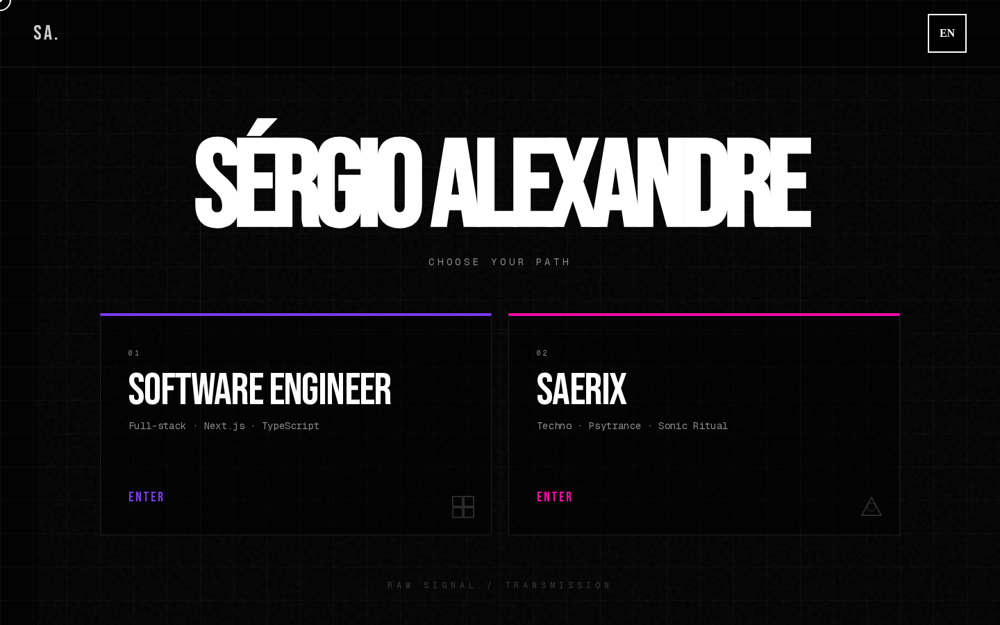
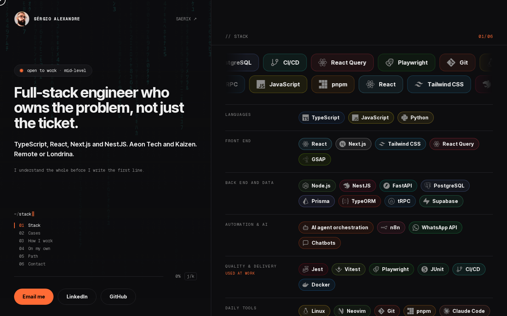
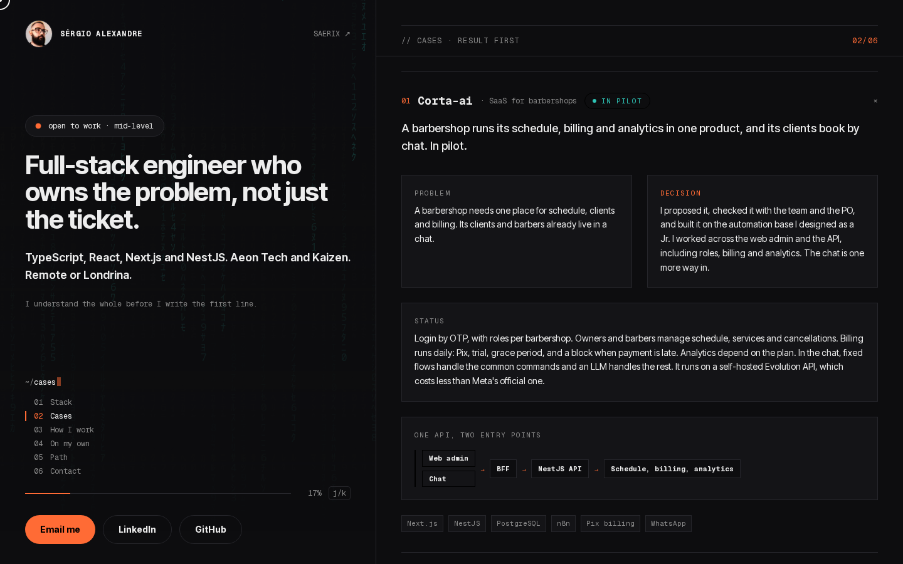
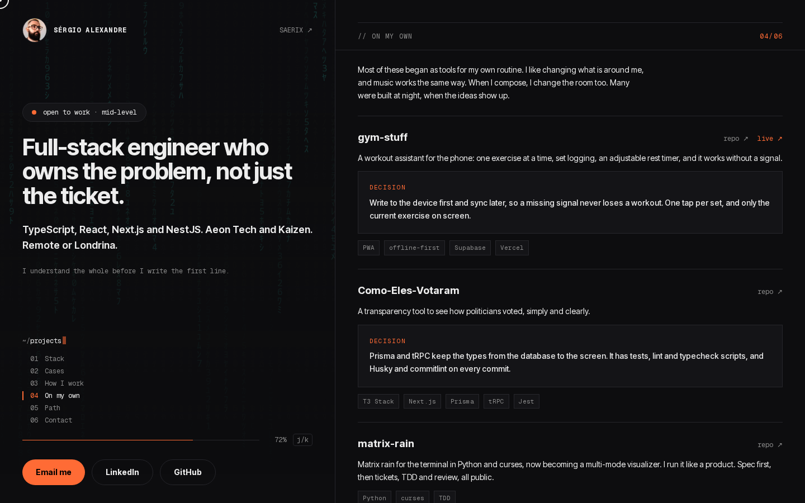
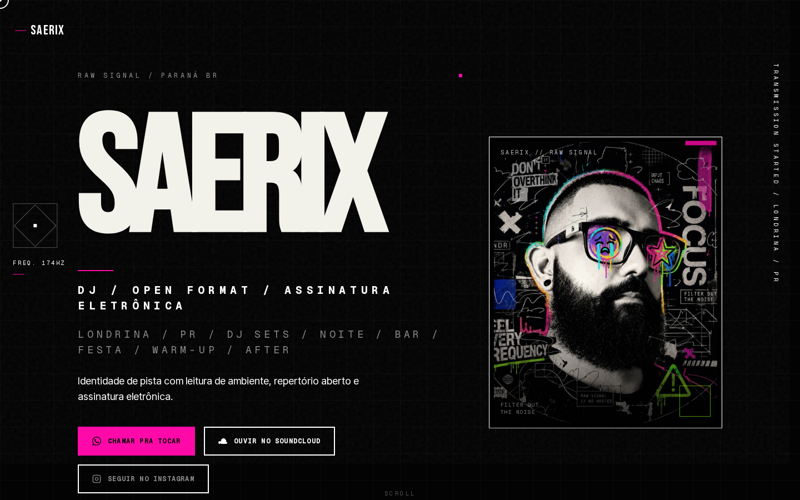
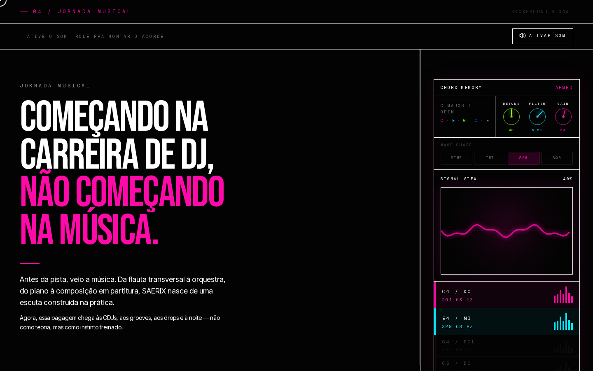
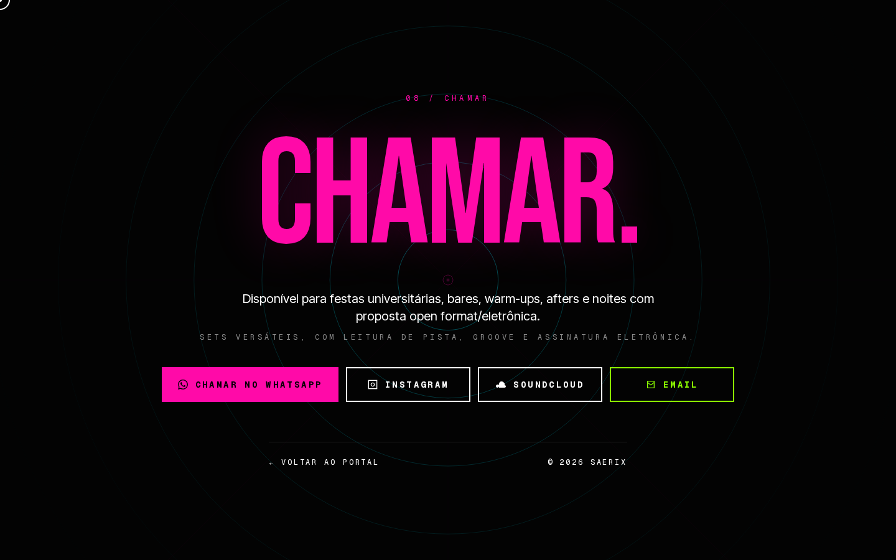

# SAERIX Portfolio

Personal site of Sérgio Alexandre, with two faces on one domain: a `/dev` page for software engineering work and a `/saerix` page for his electronic music project.

**Live:** [saerix.vercel.app](https://saerix.vercel.app) · [/en/dev](https://saerix.vercel.app/en/dev) · [/pt-BR/dev](https://saerix.vercel.app/pt-BR/dev)

## Preview

### Portal

The home page asks which side to open.



### /dev

Stack, a case written as problem and decision, and side projects.







### /saerix

The music project. Copy is in Portuguese on both locales. The musical journey section has a small synth: it plays a chord as you scroll once sound is enabled.







## What is in it

| Route | What it is |
| --- | --- |
| `/` | Portal where the visitor picks a path (dev or music) |
| `/dev` | Engineering page, written as a decision log: three cases, a career path, the stack and side projects. A fixed hero on the left, a terminal-style index on the right |
| `/saerix` | The music project: manifesto, musical journey, booking. `/lxndr` redirects here |
| `/sobre`, `/projetos`, `/contato` | About, project proof and contact |
| `/blog`, `/ensaios`, `/laboratorio` | MDX writing: technical posts, long-form essays, lab notes |
| `/og` | Open Graph image route |

Every route exists in English (`/en/...`) and Brazilian Portuguese (`/pt-BR/...`).

## Stack

- Next.js 16 (App Router, Server Components by default), React 19, TypeScript 5
- Tailwind CSS 3.4 and shadcn/ui (Radix primitives)
- GSAP with ScrollTrigger and SplitType for the motion
- next-intl for routing and messages (`messages/en.json`, `messages/pt-BR.json`)
- MDX content through `next-mdx-remote`, `gray-matter`, `reading-time` and Shiki
- React Hook Form and Zod for forms
- pnpm, ESLint, Vercel and Vercel Analytics

## Running locally

Requires Node.js 20+ and pnpm. No environment variables are needed.

```bash
pnpm install
pnpm dev        # http://localhost:3000
```

| Script | What it does |
| --- | --- |
| `pnpm dev` | Dev server |
| `pnpm build` | Production build |
| `pnpm start` | Serve the production build |
| `pnpm lint` | ESLint |
| `pnpm exec tsc --noEmit` | Type check |

`NEXT_PUBLIC_BASE_URL` overrides the site URL used for canonicals, the sitemap and Open Graph tags. It defaults to `https://saerix.vercel.app`.

## Layout

```
app/
  [locale]/            Routes, one folder per page
  og/                  Open Graph image
  sitemap.ts
components/
  portfolio/           Dev-side sections
    rebrand-prototype/ The /dev decision log (copy.ts and story.ts hold the content)
  lxndr/               Music-side sections
  portal/              Landing portal
  blog/  ui/  shared/
content/               MDX: posts, essays, laboratory
messages/              en and pt-BR strings
i18n/                  next-intl routing
lib/                   Constants, GSAP setup, blog loaders
docs/                  Specs and agent docs
```

Copy for `/dev` lives in `components/portfolio/rebrand-prototype/copy.ts` and `story.ts`, with both locales side by side. The design intent for the page is in [`docs/specs/dev-decision-log.md`](docs/specs/dev-decision-log.md).

## Known gaps

- `next.config.mjs` sets `typescript.ignoreBuildErrors`, so `pnpm build` does not fail on type errors. Run `tsc --noEmit` separately until that is cleaned up.
- There is no unit test setup. `e2e.spec.ts` and `test-qa.mjs` are ad-hoc Playwright smoke scripts, not wired into a script or CI.
- Motion respects `prefers-reduced-motion`, but a full accessibility audit has not been done.

## License

© Sérgio Alexandre. All rights reserved. The code is public to read; please do not reuse the content, design or music assets.
